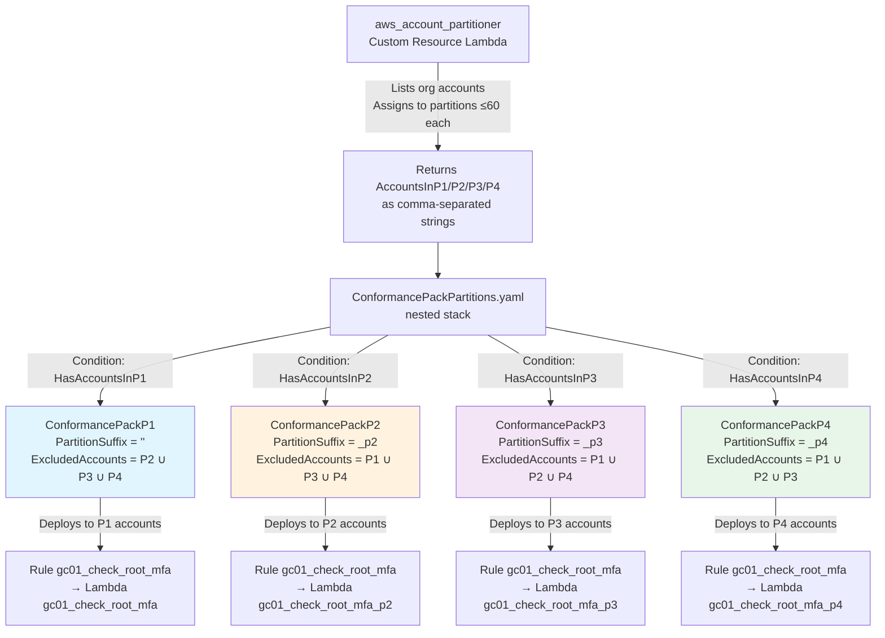

# Conformance Pack Partitioning — Proposed Solution

This document describes the proposed approach for routing per-account
guardrail evaluation through the partitioned Lambda clones introduced in
[`RESOURCE_POLICY_FIX.md`](./RESOURCE_POLICY_FIX.md). It is a companion
to that broader fix.

## Context

In the original Resource Policy Fix design document, the goal was to
have a CloudFormation Custom Resource (i.e.
**`aws_account_partitioner`**) output an Account → Partition mapping
that could be fed downstream to **`ConformancePack.yaml`** to look up
the Lambda partition to use for each account based on the
`AWS::AccountId` parameter. **However, CloudFormation doesn't support
passing `Mappings` as a template parameter (only defined in the
template), and there don't seem to be any suitable alternatives to
derive an account's partition within `ConformancePack.yaml` solely
using input parameter values.**

Therefore, we are left with the question: **how does
`ConformancePack.yaml` route each account's Config rules to the correct
partition's Lambda clone?**

The approach below answers this by deploying up to four
**Organization Conformance Packs** — one per non-empty partition —
each running the same 37-rule template but parameterised to invoke a
different Lambda clone set. `ExcludedAccounts` on each pack ensures
every org account receives **exactly one** pack: the one matching the
partition it has been assigned to in DynamoDB.

## How it would work

1. **`aws_account_partitioner`** (Custom Resource Lambda) would run
   early in `main.yaml`. It lists all org accounts, assigns each to a
   partition (≤ 60 accounts each, up to 4 partitions → 240 accounts),
   and returns the per-partition account lists as comma-separated
   strings (`AccountsInP1` / `AccountsInP2` / `AccountsInP3` /
   `AccountsInP4`).
2. A nested CloudFormation stack would receive those four lists and
   create up to four `AWS::Config::OrganizationConformancePack`
   resources, each guarded by a `Condition` that checks whether its
   account list is non-empty.
3. Each pack sets a different `PartitionSuffix` input parameter on the
   shared `ConformancePack.yaml` template in S3, so its 37 Config
   rules invoke the matching guardrail-Lambda clone set
   (`<org>gcXX_…` / `…_p2` / `…_p3` / `…_p4`). Note: the
   suffix only flows into Lambda function ARNs, **not** into
   `ConfigRuleName` — AWS Config's conformance-pack template engine
   silently ignores `!Sub` in `ConfigRuleName`, so rule names are
   static literals across all four packs.
4. Each pack's `ExcludedAccounts` would list every account in the
   *other* partitions, so the org-wide deployment targets each account
   from exactly one pack.

### Flow diagram



---

## Component-by-component

### 1. `ConformancePack.yaml` — parameterised rule routing

A new top-level parameter would be added:

```yaml
PartitionSuffix:
  Type: String
  Default: ""
  AllowedValues: ["", "_p2", "_p3", "_p4"]
```

and appended to the Lambda function-name portion of every
`SourceIdentifier` (37 substitutions). `ConfigRuleName` is left as a
static literal — see the note above. Example:

```yaml
# Before
ConfigRuleName: gc01_check_root_mfa
Source:
  Owner: CUSTOM_LAMBDA
  SourceIdentifier:
    Fn::Join:
      - ""
      - - "arn:aws:lambda:ca-central-1:"
        - Ref: AuditAccountID
        - !Sub ":function:${OrganizationName}gc01_check_root_mfa"

# After
ConfigRuleName: gc01_check_root_mfa                              # unchanged
Source:
  Owner: CUSTOM_LAMBDA
  SourceIdentifier:
    Fn::Join:
      - ""
      - - "arn:aws:lambda:ca-central-1:"
        - Ref: AuditAccountID
        - !Sub ":function:${OrganizationName}gc01_check_root_mfa${PartitionSuffix}"
```

So when the P2 pack passes `PartitionSuffix: "_p2"`, the deployed rule
name stays `gc01_check_root_mfa` and it targets the
`<org>gc01_check_root_mfa_p2` Lambda clone. Each account ever
receives at most one pack (see `ExcludedAccounts`), so the identical
rule names across packs never collide within an account.

### 2. `ConformancePackPartitions.yaml` — the nested stack

The single inline `AWS::Config::OrganizationConformancePack` in
`main.yaml` would be replaced by a nested CloudFormation stack
containing up to four of them. The reason for using a nested stack
rather than declaring four packs directly in `main.yaml` is that
**CloudFormation `Conditions` cannot reference `!GetAtt` from a Custom
Resource** — they are evaluated at template-processing time, before
any resources (or custom resources) have run. By passing the
per-partition account lists into a nested stack as regular parameters,
the nested stack *can* use them in `Conditions`.

Inputs to the nested stack:

| Parameter | Source | Purpose |
|---|---|---|
| `AccountsInP1` / `AccountsInP2` / `AccountsInP3` / `AccountsInP4` | `!GetAtt InvokeAccountPartitioner.AccountsInPx` | Comma-separated lists of account IDs. Empty string when a partition has no accounts. Drives both the per-pack `Condition` and the per-pack `ExcludedAccounts`. |
| `GC03AlarmList` | (default) | Comma-separated CloudWatch alarm names forwarded to every pack as the `GC03AlarmList` input parameter. Has a hard-coded default so callers never need to set it. |
| `PipelineBucket`, `DeployVersion` | Parent | Resolve `s3://…/ConformancePack.yaml`. |
| `InvokeUpdate` | Parent | Forwarded as `UpdateTriggerVersion`. |
| `OrganizationName`, `AccelRolePrefix`, `AuditAccountID`, `BGA1-4`, `LogArchiveAccountName`, `ClientEvidenceBucket`, `GC04EnterpriseMonitoring…` | Parent | Forwarded into the `ConformancePackInputParameters` of each pack. |

Conditions:

```yaml
HasAccountsInP1: !Not [!Equals [!Ref AccountsInP1, ""]]
HasAccountsInP2: !Not [!Equals [!Ref AccountsInP2, ""]]
HasAccountsInP3: !Not [!Equals [!Ref AccountsInP3, ""]]
HasAccountsInP4: !Not [!Equals [!Ref AccountsInP4, ""]]

# Pair combinations (6) used by the ExcludedAccounts !If ladders:
HasAccountsInP1AndP2: !And [!Condition HasAccountsInP1, !Condition HasAccountsInP2]
HasAccountsInP1AndP3: !And [!Condition HasAccountsInP1, !Condition HasAccountsInP3]
HasAccountsInP1AndP4: !And [!Condition HasAccountsInP1, !Condition HasAccountsInP4]
HasAccountsInP2AndP3: !And [!Condition HasAccountsInP2, !Condition HasAccountsInP3]
HasAccountsInP2AndP4: !And [!Condition HasAccountsInP2, !Condition HasAccountsInP4]
HasAccountsInP3AndP4: !And [!Condition HasAccountsInP3, !Condition HasAccountsInP4]

# Triple combinations (4) — the "all other partitions non-empty" case per pack:
HasAccountsInP2AndP3AndP4: !And [!Condition HasAccountsInP2AndP3, !Condition HasAccountsInP4]
HasAccountsInP1AndP3AndP4: !And [!Condition HasAccountsInP1AndP3, !Condition HasAccountsInP4]
HasAccountsInP1AndP2AndP4: !And [!Condition HasAccountsInP1AndP2, !Condition HasAccountsInP4]
HasAccountsInP1AndP2AndP3: !And [!Condition HasAccountsInP1AndP2, !Condition HasAccountsInP3]
```

That is **14 conditions**. The combinatorics are why 4 is a practical
stopping point for this hand-written approach: each pack needs a
ladder covering all `2^(N-1)` emptiness states of the other
partitions, so a 5th partition would need 30 conditions and 15-branch
ladders.

Resources:

| Resource | Condition | `PartitionSuffix` | `ExcludedAccounts` |
|---|---|---|---|
| `ConformancePackP1` | `HasAccountsInP1` | `""` | 7-branch nested `!If` over `(P2, P3, P4)`: union of whichever of P2/P3/P4 are non-empty, or `!Ref AWS::NoValue` if all empty. |
| `ConformancePackP2` | `HasAccountsInP2` | `"_p2"` | 7-branch nested `!If` over `(P1, P3, P4)`. |
| `ConformancePackP3` | `HasAccountsInP3` | `"_p3"` | 7-branch nested `!If` over `(P1, P2, P4)`. |
| `ConformancePackP4` | `HasAccountsInP4` | `"_p4"` | 7-branch nested `!If` over `(P1, P2, P3)`. |

Pack names:

```
${OrganizationName}-GC-CP-Guardrails-P1    ← when AccountsInP1 is non-empty (always, in practice)
${OrganizationName}-GC-CP-Guardrails-P2    ← when AccountsInP2 is non-empty
${OrganizationName}-GC-CP-Guardrails-P3    ← when AccountsInP3 is non-empty
${OrganizationName}-GC-CP-Guardrails-P4    ← when AccountsInP4 is non-empty
```

For organizations with ≤ 60 active accounts the behaviour is
functionally **indistinguishable** from the pre-fix deployment: one
pack with no exclusions, base `gc*` Lambda set only. The pack name
picks up a `-P1` suffix — this is the one visible break with earlier
deployments, and it exists specifically to sidestep a
`ConformancePackAlreadyExistsException` during in-place upgrades from
the pre-partition template. The upgrade path otherwise requires no
manual configuration.

Each pack's `ExcludedAccounts` is built with a nested `!If` ladder so
empty `AccountsInP*` strings are never `!Split`/`!Join`'d into the
list (which would produce trailing empty elements failing Config's
`^\d{12}$` validation). With four partitions each ladder has
**seven** branches — one per non-empty subset of the other three
partitions — plus the `AWS::NoValue` fallback. Worked example for
`ConformancePackP1`:

```yaml
ConformancePackP1:
  Type: AWS::Config::OrganizationConformancePack
  Condition: HasAccountsInP1
  Properties:
    OrganizationConformancePackName: !Sub "${OrganizationName}-GC-CP-Guardrails-P1"
    TemplateS3Uri: !Sub "s3://${PipelineBucket}/${DeployVersion}/ConformancePack.yaml"
    ExcludedAccounts: !If
      - HasAccountsInP2AndP3AndP4
      - !Split [",", !Join [",", [!Ref AccountsInP2, !Ref AccountsInP3, !Ref AccountsInP4]]]
      - !If
        - HasAccountsInP2AndP3
        - !Split [",", !Join [",", [!Ref AccountsInP2, !Ref AccountsInP3]]]
        - !If
          - HasAccountsInP2AndP4
          - !Split [",", !Join [",", [!Ref AccountsInP2, !Ref AccountsInP4]]]
          - !If
            - HasAccountsInP3AndP4
            - !Split [",", !Join [",", [!Ref AccountsInP3, !Ref AccountsInP4]]]
            - !If
              - HasAccountsInP2
              - !Split [",", !Ref AccountsInP2]
              - !If
                - HasAccountsInP3
                - !Split [",", !Ref AccountsInP3]
                - !If
                  - HasAccountsInP4
                  - !Split [",", !Ref AccountsInP4]
                  - !Ref AWS::NoValue
    ConformancePackInputParameters:
      - ParameterName: PartitionSuffix
        ParameterValue: ""
      - ParameterName: UpdateTriggerVersion
        ParameterValue: !Ref InvokeUpdate
      - ParameterName: OrganizationName
        ParameterValue: !Ref OrganizationName
      - ParameterName: AuditAccountID
        ParameterValue: !Ref AuditAccountID
      - ParameterName: GC03AlarmList
        ParameterValue: !Ref GC03AlarmList
      # … remaining input parameters (BGA1-4, S3*Path, etc.)
```

Note the branch **ordering**: the three-partition case must be tested
first, then the three two-partition cases, then the three
single-partition cases. A pair condition such as `HasAccountsInP2AndP3`
is also true when P4 is non-empty, so testing it before
`HasAccountsInP2AndP3AndP4` would silently drop P4's accounts from the
exclusion list and double-target them.

`ConformancePackP2`, `ConformancePackP3` and `ConformancePackP4` are
structurally identical, each substituting its own `PartitionSuffix`
(`"_p2"` / `"_p3"` / `"_p4"`), its own `Condition`, its own pack name
suffix, and a ladder over the *other three* partitions:

| Pack | Ladder order |
|---|---|
| `ConformancePackP1` | P2∧P3∧P4 → P2∧P3 → P2∧P4 → P3∧P4 → P2 → P3 → P4 → `NoValue` |
| `ConformancePackP2` | P1∧P3∧P4 → P1∧P3 → P1∧P4 → P3∧P4 → P1 → P3 → P4 → `NoValue` |
| `ConformancePackP3` | P1∧P2∧P4 → P1∧P2 → P1∧P4 → P2∧P4 → P1 → P2 → P4 → `NoValue` |
| `ConformancePackP4` | P1∧P2∧P3 → P1∧P2 → P1∧P3 → P2∧P3 → P1 → P2 → P3 → `NoValue` |

All 16 emptiness combinations across the four partitions have been
simulated to confirm every account lands in exactly one pack and that
no `ExcludedAccounts` list ever contains an empty or malformed entry.

#### `ExcludedAccounts` service-limit headroom

The AWS Config API caps `ExcludedAccounts` at **1000 entries** per organization conformance pack, substantially more than required for this solution.
([AWS Config API reference](https://docs.aws.amazon.com/config/latest/APIReference/API_PutOrganizationConformancePack.html#config-PutOrganizationConformancePack-request-ExcludedAccounts) — *"Array Members: Minimum number of 0 items. **Maximum number of 1000 items.** Pattern: `\d{12}`"*).

### 3. `main.yaml` — nested-stack invocation

The existing inline `AWS::Config::OrganizationConformancePack` resource
would be replaced by an `AWS::CloudFormation::Stack` resource that
delegates to `ConformancePackPartitions.yaml`. Because the resource
`Type` changes (Config pack → nested stack), the logical ID is
**renamed** from `ConformancePack` to `ConformancePackStack` —
CloudFormation forbids in-place `Type` changes on a given logical ID.
The `EvidenceCollectionComponents` `DependsOn: ConformancePack`
reference is updated to `ConformancePackStack` in the same commit.

The nested stack receives only the per-partition account-list
`!GetAtt`s from the partitioner; whether each pack is created is
driven entirely by emptiness of those account lists.

### 4. `aws_account_partitioner/app.py` — per-partition account lists

Two additions:

1. **New `build_partition_account_lists` helper.** Returns a dict
   mapping every partition slot 1…`MAX_PARTITIONS` to a sorted list of
   account IDs, with empty lists for slots above the current
   `partitionCount`.
2. **`AccountsInP1` / `AccountsInP2` / `AccountsInP3` / `AccountsInP4`
   in the Custom Resource response.** Each is a comma-separated string
   of 12-digit account IDs (empty string when its partition has no
   accounts). The shape is the same in both invocation contexts
   (CloudFormation Custom Resource and Step Function step), produced by
   a shared `_build_cfn_response_data` helper.

The assignment algorithm itself is unchanged from the pre-fix design:
new accounts are sorted, then placed greedily into the lowest-numbered
partition with capacity, opening new partitions as needed up to
`MAX_PARTITIONS`.

If a previously-populated trailing partition becomes empty (every
account in it gets disabled / removed) the partitioner reduces
`partitionCount` to the highest occupied partition — so a 4-partition
org that loses all of P4 will report `partitionCount=3` on the next
run, and `ConformancePackP4` will be deleted on the resulting stack
update. Non-trailing partitions are *not* collapsed (P2 emptying with
P3 still occupied leaves `partitionCount=3` and only suppresses the P2
pack via its emptiness condition).

#### CloudFormation 4 KB response-body cap — and the graceful failure

The CloudFormation Custom Resource response body is capped at 4096
bytes, and this is the binding constraint on the whole design. With
`MAX_ACCOUNTS_PER_PARTITION × MAX_PARTITIONS = 60 × 4 = 240` account
IDs at ~13 bytes each (12 digits + comma), the combined `AccountsInPx`
payload plus envelope measures **3737 bytes** — about 350 bytes of
headroom. Measured body sizes:

| Active accounts | `count` | Body size |
|---:|:---:|---:|
| 1 | 1 | 633 B |
| 60 | 1 | 1400 B |
| 120 | 2 | 2179 B |
| 180 | 3 | 2958 B |
| 240 (max) | 4 | **3737 B** (measured) |

Because the margin at full scale is thin, the partitioner **measures
its own response before sending it**:

```python
CFN_RESPONSE_MAX_BYTES = 4096
CFN_RESPONSE_SAFETY_MARGIN_BYTES = 128
CFN_RESPONSE_WARN_RATIO = 0.85
```

`assert_cfn_response_fits()` serialises the exact body that `send()`
would PUT to the pre-signed S3 URL and then:

- logs a **WARNING** when the body exceeds 85 % of the cap (expected
  at 240 accounts, and an early signal that the org is approaching the
  design ceiling); and
- raises a `RuntimeError` when the body exceeds
  `4096 − 128 = 3968` bytes, *before* attempting the send.

The raised error is caught by the handler's existing `except` block,
which returns a `FAILED` Custom Resource status with the message as
the CloudFormation `Reason`. The result is a clean, explanatory stack
rollback instead of CloudFormation hanging for an hour waiting on a
response that was silently rejected by S3. The message explicitly
notes that **raising `MaxPartitions` will not help** — more partitions
make this response *larger*, not smaller — and points at
`doc/RESOURCE_POLICY_FIX.md` for the remediation discussion.

### 5. Evidence collection — org Config Aggregator (Audit Manager retired)

Audit Manager has been removed from this solution (deprecated by AWS).
The daily `aws_compile_audit_report` Lambda now sources guardrail
compliance directly from the org AWS Config Aggregator by querying
`AWS::Config::ResourceCompliance` items and filtering on the
`gc\d\d_check_*` rule-name pattern. Because that name is identical across
every account regardless of partition (`PartitionSuffix` only flows into
Lambda ARNs, not into `ConfigRuleName`), the aggregator merges evidence
from P1/P2/P3/P4 automatically with no per-partition configuration.

#### Forward-compatibility with org growth

When the organisation later scales past 60 (or 120, or 180) accounts and
`ConformancePackP2` (or `P3`, or `P4`) gets deployed, the
previously-non-existent P2/P3/P4 accounts begin producing evaluations of
the same `gc01_check_root_mfa` rule that the aggregator picks up on the
next collection cycle — no evidence-pipeline redeploy, no manual
reconciliation, no control rename.

---

## How it would behave at each scale

| Active accounts | Partitions | Packs deployed | Behaviour |
|---:|:---:|:---|:---|
| 1–60 | 1 | `…-GC-CP-Guardrails` only | Identical to pre-fix deployment. No `ExcludedAccounts`. Every account targets base `<org>gc*` Lambdas. |
| 61–120 | 2 | `…` + `…-P2` | Each pack lists the *other* partition's accounts in `ExcludedAccounts`, so every account receives exactly one pack. P1 accounts target base Lambdas; P2 accounts target `_p2` clones. |
| 121–180 | 3 | `…` + `…-P2` + `…-P3` | Each pack excludes the union of the other two partitions' accounts. Three sets of Lambda clones, three packs, every account in exactly one of them. |
| 181–240 | 4 | `…` + `…-P2` + `…-P3` + `…-P4` | **Maximum supported scale.** Each pack excludes the union of the other three partitions' accounts. The partitioner's Custom-Resource response measures ~3.74 KB here — within ~350 bytes of CloudFormation's 4096-byte cap — so a WARNING is logged above 85 % utilisation. |
| >240 | — | (failure) | `assign_partitions` raises; the Custom Resource returns `FAILED` with an actionable `Reason`. Raising `MaxPartitions` past 4 is **not** a valid remediation — a 5th partition would push the response over the 4 KB cap. Raising `MaxAccountsPerPartition` is also unsafe (60 is set by the 20 KB Lambda resource-policy limit). Supporting more accounts requires a design change away from returning full account lists through the Custom-Resource response. |

The assignment of any specific account to a specific partition is
**stable** once made: existing rows in the
`gc-guardrails-partition-state` DynamoDB table are never reassigned by
the partitioner — only new accounts are placed.

---

## Audit Manager evidence routing

Each guardrail is one Audit Manager *control* with a single
`controlMappingSources` entry. The same `Custom_<rule>-conformance-pack`
keyword matches the (identically-named) deployed Config rule in every
account across all four partitions, so evidence aggregation in the
assessment is automatic:

```
AWS Config (partition 1 accounts)  ──┐
   evaluating gc01_check_root_mfa    │
                                     │
AWS Config (partition 2 accounts)  ──┤    Audit Manager
   evaluating gc01_check_root_mfa    ├──> control:
                                     │    "gc01_check_root_mfa"
AWS Config (partition 3 accounts)  ──┤    (single control, single
   evaluating gc01_check_root_mfa    │     keyword, evidence merged
                                     │     across all accounts)
AWS Config (partition 4 accounts)  ──┘
   evaluating gc01_check_root_mfa
```

`aws_compile_audit_report` consumes Audit Manager evidence folders
keyed by control *name*, not Config rule name. The control names are
unchanged by this work, so the CSV report rows continue to be grouped
by the original 38 guardrail control names regardless of how many
partitions are in play.
